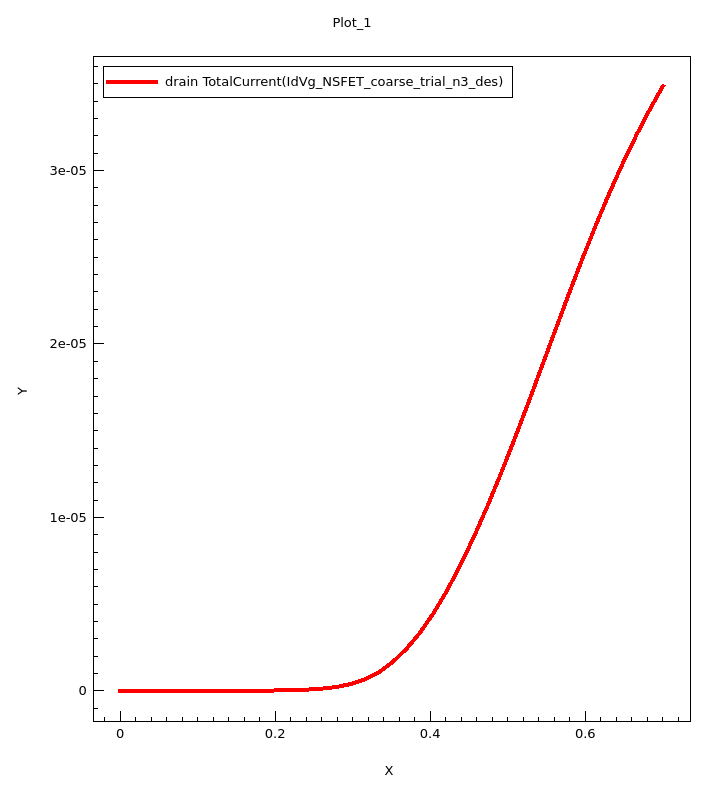
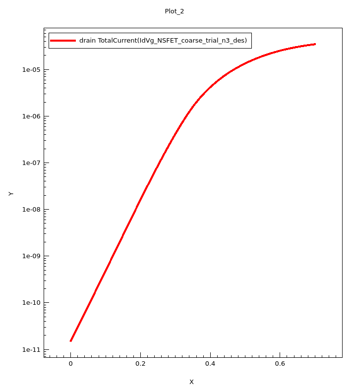
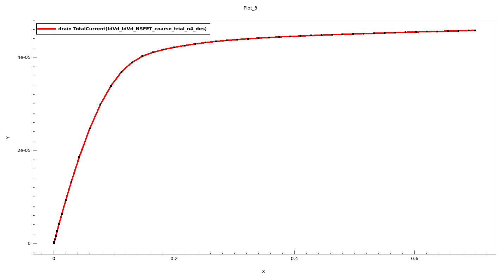
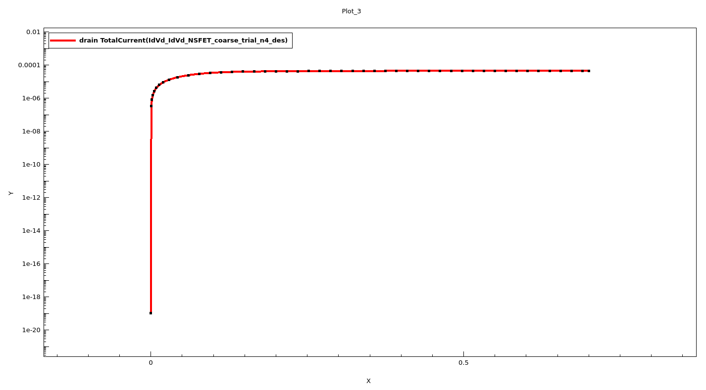
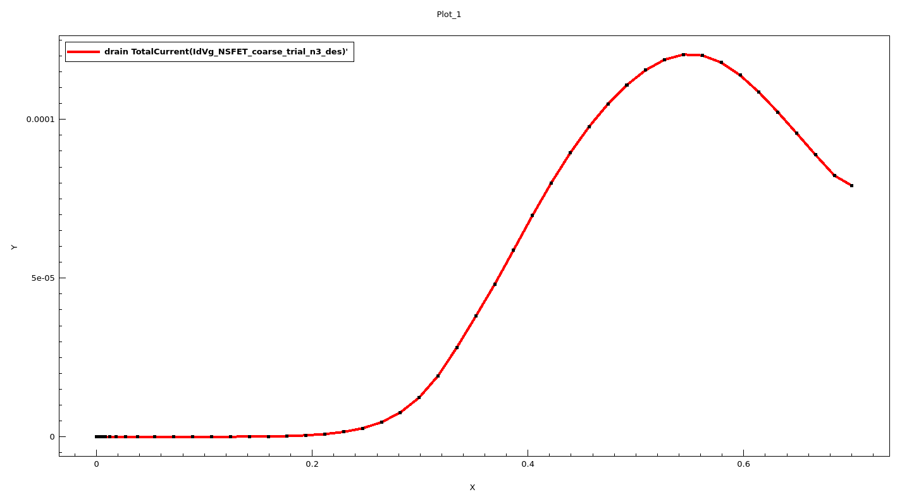
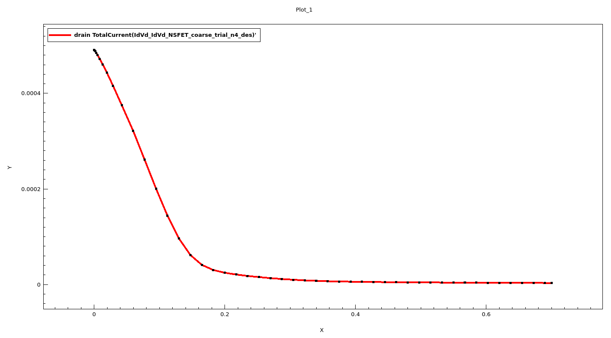
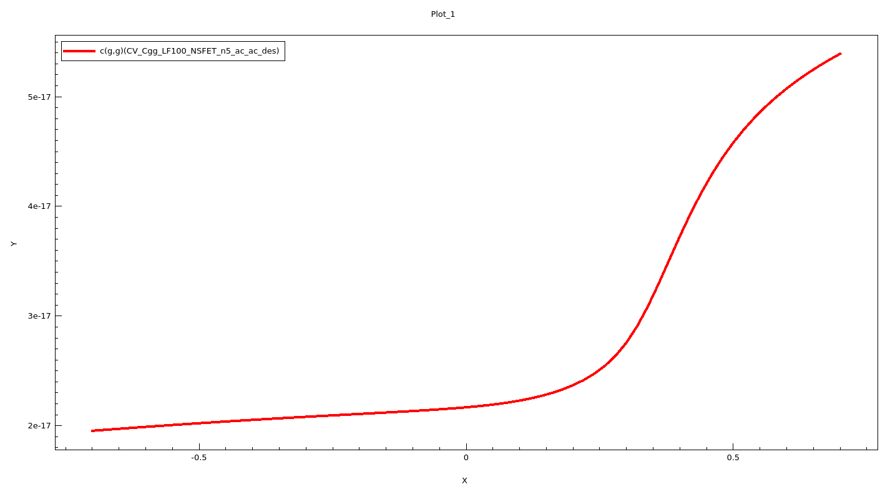
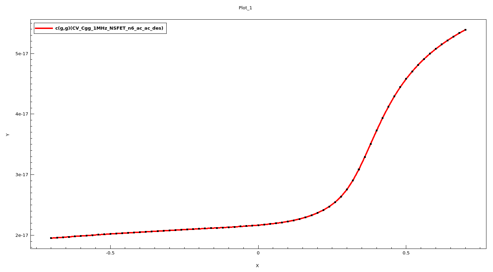

# NSFET: Ongoing TCAD Research

An ongoing nanosheet FET (NSFET) simulation project using technology computer-aided design (TCAD). This portfolio selection focuses on reading terminal electrical characteristics and presenting simulation outputs. The specific research question and device implementation remain confidential.

## Tools and workflow

- **Synopsys Sentaurus Workbench:** organizing the simulation workflow.
- **Sentaurus Device:** producing terminal current and small-signal electrical outputs.
- **Sentaurus Visual:** inspecting curves on linear and logarithmic scales and examining derivative characteristics.

The selected outputs cover transfer characteristics, output characteristics, current derivatives, and gate-capacitance sweeps. Together, they illustrate different ways to examine a simulated device: how current responds to gate bias, how it responds to drain bias, and how gate capacitance varies during a voltage sweep.

## How to read the graphs

These are original exported plots, not redrawn or enhanced results. Their axes are labeled only **X** and **Y**. The quantity descriptions below are interpretations based on supplied filenames, visible legends, and corresponding terminal-data fields. **The images do not print units or normalization, and neither is verified here.** Do not interpret plotted current as current per unit width or use these screenshots alone for quantitative benchmarking. The [graph guide](graph-guide.csv) records the interpretation basis and limitations for each image.

### Transfer characteristic: linear and logarithmic views

The transfer curves show drain total current against the gate-voltage sweep. The linear view emphasizes the larger-current portion of the sweep; the logarithmic-current view makes the smaller-current portion visible across several orders of magnitude. They are complementary presentations, not independent validation results.

### Output characteristic: linear and logarithmic views

The output curves show drain total current against the drain-voltage sweep. The linear plot shows a steep initial rise followed by a flatter region. The logarithmic view expands the small-current end of the characteristic. These plots are not a family of curves at multiple disclosed gate biases.

### Current-derivative characteristics

The supplied transconductance plot represents the derivative of drain current with respect to gate voltage, commonly written as **gₘ = dIᴅ/dVɢ**. Its visible curve rises, reaches a maximum, and then declines over the plotted sweep. The output-conductance plot represents the derivative with respect to drain voltage, **gᴅₛ = dIᴅ/dVᴅ**, and decreases across its sweep. Both legends mark the current expression with a prime. These derivative plots are useful for discussing local sensitivity, but numerical differentiation settings and uncertainty are not documented in this public selection.

### Gate-capacitance characteristics

The two capacitance plots show the **c(g,g)** terminal capacitance coefficient against a gate-voltage sweep. The source labels distinguish a low-frequency run marked **LF100** and a high-frequency run marked **1MHz**. Both visible curves increase more strongly toward the positive end of the sweep. They are shown separately; their apparent similarity is not a demonstrated frequency-independence result.

## What this project demonstrates

- Organizing and interpreting several types of terminal-characteristic output.
- Using linear and logarithmic scales to inspect different current ranges.
- Connecting current slopes with transconductance and output conductance.
- Distinguishing current–voltage and small-signal capacitance analyses.
- Preparing a limited public presentation while protecting confidential design work.

## Status and limitations

Research is in progress. These are illustrative simulation outputs, not measured hardware results or a validated device model. This selection does not establish mesh convergence, calibration against measurements, reproducibility, extracted performance metrics, or superiority over another device. No quantitative threshold-voltage, subthreshold-swing, gain, or on/off-ratio claim is made.

## Public files and confidentiality

This folder contains this project explanation, a graph-guide CSV, and eight selected terminal-characteristic images. It is a presentation package, not a runnable simulation release.

The research topic, device dimensions, geometry, structure design, spatial field views, material comparisons, meshes, process/structure definitions, solver decks, raw simulation databases, logs, and original research archive are not included. No original simulation file was selected as a safe basic-file release; documentation and graph exports are the public subset.
